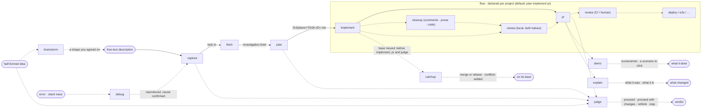
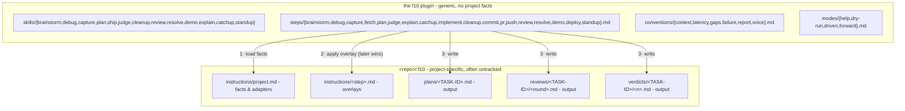
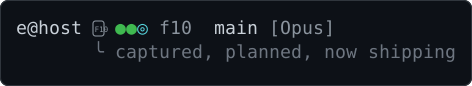

<p align="center">
  
</p>

<div align="center">

### Capture. Plan. Ship.

A language-agnostic, composable task pipeline for Claude Code.

[](https://code.claude.com/docs/en/plugins)
[](LICENSE)

</div>

---

f10 (f-ten) is a set of skills over one step chain.
**capture** turns a freely written idea into a tracked task, **plan** turns the task into an architect-grade plan on disk, and **ship** turns the plan into code and, optionally, a release.
The rest are optional: **brainstorm** before the chain, **debug** before it for a bug that arrives as an error, **judge** at any point, **review** and **resolve** before the PR, **demo** and **explain** after it, **catchup** whenever the base moved.

No stack is hard-coded: the same commands drive a Go service, a Rails app, or a Terraform repo.
f10 **infers** what it needs (the git remote gives `gh`/`glab`, build files give verify commands), or you **declare** it once in `.f10/instructions/`.

## Pipeline



Solid arrows are the default flow.
Dashed ones are optional: `brainstorm`, `debug`, `judge`, `demo`, `explain` and `catchup` when you ask, the rest where a project declares them; ship also catches up on its own when the base moved.
Each skill is an **entry point** into the chain:

| Skill | Runs | Stops at |
|---|---|---|
| `/f10:brainstorm <idea>` | brainstorm | a shape agreed in chat, or the decision not to build |
| `/f10:debug <error \| trace \| desc>` | debug, capture, fetch, plan | plan file saved on the bug path; or what to collect next, and no task |
| `/f10:judge [<idea \| id \| PR \| commit>] [--blind]` | judge | a verdict: proceed, proceed with changes, rethink, or stop |
| `/f10:capture <desc>` | capture | task created (id + url) |
| `/f10:plan [<id \| desc>]` | (capture,) fetch, plan | plan file saved, before any code; or handed to the task's own agent |
| `/f10:ship [<id \| plan.md \| desc>]` | whatever's missing, then the flow | end of the declared flow (an open PR by default); or handed to the task's own agent |
| `/f10:cleanup [comments\|prose\|code] [<path>]` | cleanup | comments cut to the why, prose to plain rules, leftovers out of the code; each diff proven in scope (a small one gets a light pass without proofs), verify green, nothing committed |
| `/f10:review <id \| PR \| this branch> [ci]` | review | a findings file from a reviewer that never saw your session, or read in from the CI review |
| `/f10:resolve <id \| PR \| this branch>` | resolve | fix, skip or ask per finding, fixes verified, asks in one questionnaire |
| `/f10:demo <PR \| id \| this branch> [--hands-on]` | demo | screenshots and a local report, or a scenario you walk |
| `/f10:explain <PR \| id \| this branch \| local \| concept \| path>` | explain | a change: what it was and is now; a thing: what it is |
| `/f10:catchup` | catchup | the branch merged or rebased onto its base, conflicts settled, verify green, nothing pushed |
| `/f10:standup [--since <date> \| --week] [-C <checkout> \| --group <name> \| --all] [--other]` | standup | a report of your work by day, project and task, printed, and drafted where your settings or the project's overlay name a delivery adapter; the next one starts where it ended |
| `/f10:status [id]` | nothing: a hook answers it; with an id, `f10 status <id>` | the run's status in words; with an id, another worktree's run and its agent's question, relayed and answered |
| `/f10:asks [id]` | nothing: it runs `f10 asks` | the questions driven agents wait on, across projects, asked in one questionnaire; each answer resumes its drive or reaches its agent |
| `/f10:read [id \| id+id]` | nothing: it runs `f10 task read` | the task, its comments and every image it links in context, opened; nothing planned or started |
| `/f10:board [<window>] [--state] [--remote] [-C <checkout>]` | nothing: it runs `f10 board` | what changed today (else the last working day), by group; with `--state`, every task's stage and next action, your own next moves offered one per line (the `next` group as one line for its first task), none run |
| `/f10:start <id \| PR url \| #n> [--plan \| --local \| --discuss] [--after <id> \| --base <branch>] [--task <id>] [--agent <profile> \| --model <model>]` | nothing: it runs `f10 start` | a new worktree, Herdr workspace and prompted agent; a PR's branch picked up |
| `/f10:drive <ids[:profile] \| id -- id> [--flow <name> \| --local] [--agent <profile> \| --model <model>]` | nothing: it runs `f10 drive` in the background | every task through its chain (plan, judge, ship, review, resolve, finish by default), bases first; a parent id expands into the subtasks you pick; agents' questions relayed |
| `/f10:finish [<id>] [--yes] [--merge \| --local]` | nothing: it runs `f10 finish` | PR merged (someone else's only when you say so), plan archived, workspace closed, worktree and branch gone, main pulled |

## Install

```
/plugin marketplace add amberpixels/f10
/plugin install f10@amberpixels
```

Per-repo setup is optional.
With no `.f10/`, steps infer what they can from the git remote and build files, so you can run immediately.
To pin a fact instead (the tracker, the verify commands, the PR flow), declare it in `.f10/instructions/project.md`; anything you leave out stays inferred.

Tasks on GitHub or GitLab issues need nothing more.
For a Notion tracker, install [f10-drivers](https://github.com/amberpixels/f10-drivers) and point `.f10/driver` at it.

## Quick start

```text
/f10:brainstorm public API abuse - rate limiting, or per-tenant quotas?
# → a discussion that writes nothing and ends in a shape, or in "we don't build this"

/f10:debug panic: assignment to entry in nil map at cache.go:42
# → reproduces and finds the cause first; only a confirmed bug becomes a task and a plan

/f10:capture Add rate limiting to the public API
# → creates the tracker task, replies with its id + url

/f10:plan ABC-1042
# → investigates the code, writes .f10/plans/ABC-1042.md, stops before any code

/f10:ship ABC-1042
# → reuses the saved plan, then runs the flow's entries after plan

/f10:ship fix the flaky retry test
# → or skip the ceremony: capture-plan-ship a small chore in one go

/f10:review
# → a reviewer that never saw this session reads the branch's diff, writes .f10/reviews/ABC-1042/1.md

/f10:resolve
# → fix, skip or ask per finding; fixes verified; every ask in one questionnaire at the end

/f10:explain
# → what this branch was and what it is now, in a few lines; runs and writes nothing

/f10:explain grace period
# → what a grace period is, the way a peer who wrote it would tell you: three or four sentences from the code

/f10:demo
# → before you merge: runs the branch, captures what it does, writes a local report.html

/f10:demo --hands-on
# → same setup, but you drive: a live url and a short scenario to click through
```

`--dry-run` on any skill reports the loaded context, routing, adapters and output paths, and executes nothing.
`--help` on any skill lists every argument it takes; the autocomplete hint shows only the common call.

## Concepts

**Pipeline**

- **Brainstorm** - the optional conversation before capture: what to build, whether to, which shape.
  It writes nothing and draws no badge glyph, and ends in a shape you hand to `/f10:capture`, or in not building.
- **Judge** - a verdict on an idea, task, plan, PR or commit range: real problem or stated one, symptom or cause, what already exists, a longer-lived shape.
  `--blind` runs it in a fresh agent that never saw the conversation.
  In a ship pipeline, proceed continues, stop ends the run blocked, and the other two open a discussion ending in your call.
  With `stale_after: 3w` in the frontmatter, a task older than that is judged before it is planned, and only proceed lets the plan go on.
  Creates nothing.
- **Review** - the bug hunt, in two halves.
  `review` gives the full diff to a **blind** reviewer (the default, with nothing declared): four core categories (correctness and logic, architecture and guidelines, security and performance, tests and docs), at most three findings each, style skipped unless it affects correctness, written to a **findings file**.
  A project adds categories under `project.md → Review`, each with a source-of-truth file, plus what never to flag.
  `resolve` gives each finding `fix`, `skip` or `ask` (`+note` for a code comment, `+reply` to answer the reviewer), re-verifies, and puts every `ask` to you in one questionnaire.
  Your stated choice beats the reviewer.
  One round is the default: a second runs only when round one fixed six or more findings, when `project.md → Review` says `Rounds: 2`, or when you ask for it.
  It reports on every prior finding first; there is no third, and what is still open goes to you.
  A `review` entry in a ship pipeline runs both halves.
- **Demo** - *what was built*, before you merge code you did not write: what changed in plain words, then a **demo script** it runs for screenshots and a local `report.html`, or (`--hands-on`) seeds the state and hands you the running app.
  The executor is declared, never guessed: a project without a `demo` overlay gets one proposed from its e2e config, dev-server recipe, seed task and test user, written to `.f10/instructions/demo.md`, along with where reports go: a local file, a private published page, or both (`--publish` / `--local` per run).
  One shot per claim, before/after only where something visible already existed, report rows only for artifacts written.
  No bug hunt, no verdict.
- **Explain** - *what is this*, for a reader who knows the codebase.
  A change becomes two to five **pairs**, what it was and what it is now; a concept, file, package or function gets three or four sentences from the code.
  Cheaper than a demo, so run it first.
- **Catchup** - brings a branch up to its base (the branch `f10 start --after` recorded, else the default branch), by merge or rebase (the `catchup: merge | rebase | off` frontmatter key; rebase by default), keeping both sides' intent: lock files regenerated, only truly ambiguous files put to you in one questionnaire.
  Red verify after a clean integration is a semantic conflict, settled the same way.
  Nothing to settle is a correct run.
  Ship hands off here on a conflict.
  Nothing is pushed.
- **Step** - the unit of work in `steps/*.md`.
  Skills are thin routers over steps.
- **Flow** - every step a task runs through, declared under `flows:` in `project.md` (default `plan implement pr`); `f10 flow` lists them.
  `plan` leads and runs only for a task with no plan file; `/f10:ship` runs the entries after it.
  An entry takes an argument after a colon: `review:local`, `review:ci`, `review:local+ci` (both halves, one resolve), `cleanup:comments,prose`, `deploy:staging`.
  `judge` before `implement` judges the plan, after it the change.
  A name with no generic step (e.g. `e2e`) is project-defined: `.f10/instructions/<name>.md` *is* the step.
  `f10 start` and `f10 drive` run `default`, `--local` runs `local`, `--flow <name>` any other.
  A flow with no leading `plan` skips the plan file, and for free text the ticket too.
- **Convention** - a rule every step obeys, in `conventions/`: `context.md` (config loading, the project.md core, stealth, task references), `latency.md` (turns, not commands), `gaps.md` (open decisions), `failure.md` (a step that cannot complete), `report.md` (what a success prints), `voice.md` (how it talks).
  A hook tells the model to load them when a skill starts and again after compaction; the project's instructions reload every run.
- **Mode** - a run in `modes/` that changes execution: `help.md` (`--help`), `dry-run.md` (`--dry-run`), `driven.md` (`--driven`, a run prompted from another session) and `forward.md` (a task id another worktree holds).

**Artifacts**

- **Task** - the tracker item.
  Its **task id** names every artifact downstream.
  Its **kind** is `feature`, `bug`, `refactor` or `spike`, read from the steering, a label or the description (a spike only from the steering or a label); the plan records it.
  A bug is reproduced and its cause traced before it is planned, and its fix starts with a test that fails first.
  A refactor proves behavior unchanged with tests green before and after.
  A spike (a research task) answers a question: its run ends at a spike report, and its code is never committed.
- **Stage** - one ordered unit inside a plan file.
  Not a step, not a skill.
- **Plan file** - `<storage root>/plans/<TASK-ID>.md`, the handoff from plan to ship.
  The storage root is anchored to the checkout root, whatever the launch directory.
  A plan only in chat is a failed run; superseded plans are archived, never edited.
  It closes with **Consequences** (what the chosen design costs and when to revisit it), then **Gaps**.
- **Findings file** - `<storage root>/reviews/<TASK-ID>/<round>.md`, from review to resolve: the reviewed sha, then one block per finding (title, summary, file and line, category, a concrete fix).
  Resolve appends verdicts and never edits the reviewer's text.
  Two rounds at most; they stay in the checkout's `.f10/`, since `f10 finish` archives only the plan.
- **Verdict file** - `<storage root>/verdicts/<TASK-ID or slug>/<n>.md`, one per judge run: a header with the subject, the verdict, its reason and, in a ship run, what the run decided, then the argument.
  An idea with no task files under a slug of the idea.
- **Spike report** - `<storage root>/spikes/<TASK-ID>.md`, a spike's shipment: the question, the answer, its evidence, the recommendation and follow-up tasks.
- **Gap** - a decision only the user can make, recorded with a default so the plan is always shippable.
  Filling gaps is one optional questionnaire.
- **Shipment** - what a ship run leaves, named by the pipeline's last step: verified code (`implement`), local commits (`commit`), pushed commits (`push`), an open PR/MR (`pr`), a running environment (`deploy`); for a spike, its spike report.
  A project with no git in its pipeline still ships.

**Project binding**

- **Project instructions** - `<checkout root>/.f10/instructions/`: `project.md` (typed facts in its frontmatter, prose below) plus optional per-step **overlays**.
  A linked worktree's instructions layer on main's unless they declare `layering: replaces`.
- **Role** - a base role per step, which a project can replace always or by area (`= senior marketing analyst` on report work), plus added roles, always or by area (`+ senior UI/UX engineer` when the task touches user-facing UI).
  Fetch settles the areas and the base role; the plan file records the roles for ship ([Roles](docs/project-setup.md#roles)).
- **Adapter** - how a capability ("fetch a task", "open a PR", "verify") binds per project: a skill or a CLI command.
  f10 names the capability; the project supplies the adapter.
- **Review** - local (pre-PR) or CI/human (post-PR), placed or omitted per pipeline; no review entry means ship stops at the PR.
  A remote review is four facts under `project.md → Review` (who posts it, where it arrives, what triggers it, what marks it done and handled), plus the mark a settled review gets, inferred by `f10 init` from a Claude Code review workflow and acted on by `f10 review pick|wait|ack|settle|trigger`; `/f10:review <id> ci` reads the latest one in, triggers a new one or hands it to `/f10:resolve <id> ci`, which reads it in, settles it and marks it.
  A declared human reviewer answers asks on a remote review; a local round's asks come to you.
- **Visibility** - `stealth` (default) or `public`.
  Stealth work reads as if f10 never existed: no mentions in commits, PRs, tickets or code comments, `.f10/` untracked via `.git/info/exclude`.
- **Storage** - `in-repo` (default: the main checkout's `.f10/`, shared by every worktree) or `out-of-tree` (`~/.f10/<project>/` holds instructions *and* plans for every worktree, nothing inside the project dir), found when the repo has no `.f10/instructions/`.

## Generic vs. project-specific



Precedence (full contract in `conventions/context.md`), later winning: the generic step, `main/project.md`, `main/<step>.md`, `worktree/project.md`, `worktree/<step>.md`, then inferred defaults.
It all arrives in one bundle, generic step files included, so a run never reads `steps/` by hand.
A linked worktree layers on main's instructions, takes them wholesale when it has none, or shuts them out with `layering: replaces`.
Plans always land in the current worktree.

## Status line

Most of a run scrolls past unseen.
Three glyphs in Claude Code's [status line](https://code.claude.com/docs/en/statusline), behind an F10 keycap icon, say where it is:



Done is green, running is bright cyan, and the keycap is the Nerd Font glyph `md-keyboard_f10` (U+F12B4).
It is a drawing, not a screenshot: that private-use codepoint shows as an empty box outside a patched terminal font, GitHub included.

| glyph | phase state |
|---|---|
| `○` | pending - has not run |
| `◎` | running |
| `●` | done |
| `◉` | prior - done before this run (`/f10:ship ABC-1` reusing a saved plan) |
| `◌` | skipped - will not happen this run (a planless flow never plans) |
| `󰅚` (U+F015A) | partial - stopped, but work survived (committed but push failed, PR open but CI red) |
| `✗` | failed - the run stopped here with nothing usable |
| `󰜺` (U+F073A) | blocked - a judge verdict ended the run; nothing broke, the user decided |

Partial's `󰅚` is `md-close-circle-outline` (U+F015A) and blocked's `󰜺` is `md-cancel` (U+F073A), Nerd Font private-use codepoints: empty boxes on GitHub, correct in a patched terminal font, and real characters if you copy the code span.

Each state has its own shape; color only reinforces it, since red and green collapse in a daltonized theme.
`NO_COLOR` and `F10_STATE_COLOR=0` drop the color.

A normal run stays three glyphs wide; a stopped one adds its step: `◉ ● 󰜺 judge` reads as "blocked at judge".
The task, the reason and what unblocks it are in `f10 status`:

```
task      GH-26
url       https://github.com/amberpixels/f10/issues/26
capture   prior
plan      done
ship      blocked at judge
note      stop: the change patches the symptom, the cause is the retry loop in sync.go
next      move the retry into the client and re-run /f10:ship GH-26
updated   4m ago
```

Bare `f10 status` reads the current task the way `f10 status <id>` does, gates included: the task this session's run records, else the one the branch or the worktree's name carries.
In the main checkout, where the branch names no task, a session that ran `f10 start` or `f10 drive` gets a `launched here` tree first: a row per task it started or drove that is still live, nested under its `After:` base as a parent's subtasks are, finished ones and done or cancelled drives left out, `--json` printing task rows.
With no task to name, a terminal lists this repo's live runs (`--all` for every session on the machine, `--json` for scripts).
A named task makes `--json` take the shape `f10 status <id>` prints: a run list, the fallback object, or task rows.
Inside a session, `! f10 status` has the session id already; `/f10:status` is answered by the plugin's hook before a model runs, so it costs no tokens, unless the `launched here` tree holds a question a driven agent waits on, which goes to the model to ask and forward.

`f10 status 1042` reads another run: the one in the worktree that has the task's branch.
An agent there runs **driven** ([modes/driven.md](modes/driven.md)): instead of asking in a pane nobody watches, it writes its questions to run state as one `ask` row and stops blocked.
`/f10:status 1042` puts them to you and sends the answers back through `f10 forward`.

<details>
<summary>Why circles-by-fill, and the three Nerd Font exceptions</summary>

A codepoint your font lacks is substituted from another font with its own baseline, and the badge renders off the line.
`◐` is missing from JetBrains Mono, Fira Code and Hack, so it is not used.
If a glyph still lands wrong, `F10_STATE_GLYPHS` replaces the set.

Three glyphs are Material Design icons only [Nerd Fonts](https://www.nerdfonts.com) carry: the label `md-keyboard_f10` (U+F12B4), a whole keycap in one cell; partial's `md-close-circle-outline` (U+F015A), since no crossed circle exists across those fonts (`⊗` is absent from Fira Code); and blocked's `md-cancel` (U+F073A), since `⊘` is missing even from the Nerd Fonts.
Elsewhere each degrades to one tofu cell, and the circles still read.

</details>

### Wiring it up

Claude Code applies only `agent` and `subagentStatusLine` from a plugin's settings, so a plugin cannot ship a `statusLine`; add this to `~/.claude/settings.json` yourself.
f10 re-points `~/.claude/f10/statusline` at its current install every session start, so the path survives plugin updates:

```sh
input=$(cat)                                                             # you already do this
f10=$(printf '%s' "$input" | "$HOME/.claude/f10/statusline" 2>/dev/null)  # ← add
printf '%s@%s%s %s' "$user" "$host" "$f10" "$dir"                        # ← drop it in anywhere
```

The segment brings its own leading space and is empty when no run is live, so it fits anywhere, even between `user@host` and the directory.

Set `"refreshInterval": 2` on `statusLine` too; otherwise it refreshes only on assistant messages, and a long implement step shows a stale glyph.
`f10 doctor` says whether the status line is wired; `f10-state.sh doctor` reports where state lives, whether the symlink is in place, and what the badge renders now.

State is one small file per session in `~/.claude/f10/state/`, outside every repo (stealth wants nothing f10-shaped in a project).
`/clear` starts a new session and retires the badge; a file older than the TTL stops rendering.

| variable | default | |
|---|---|---|
| `F10_STATE_DIR` | `~/.claude/f10/state` | where state files live |
| `F10_STATE_TTL` | `86400` | seconds before a badge reads as stale |
| `F10_STATE_COLOR` | `1` | `0` (or `NO_COLOR`) for shapes without color |
| `F10_STATE_LINK` | `1` | `0` to drop the hyperlink on the task id |
| `F10_STATE_GLYPHS` | `○ ◎ ● ◌ ✗ ◉ 󰅚 󰜺` | pending, running, done, skipped, failed, prior, partial, blocked |

Overriding `F10_STATE_GLYPHS` takes all eight positions; the last two hold the real U+F015A and U+F073A.
`F10_STATUS_GLYPHS` does the same for the icons in `f10 status` trees (open PR, merged PR, review, judge), four positions ([docs/cli.md](docs/cli.md)).

<details>
<summary>How the badge stays current: two writers</summary>

- **Hooks** (`hooks/hooks.json`) - every state hook runs `f10 hook`, which reads the payload once.
  `UserPromptExpansion` and `PreToolUse` catch a skill starting, typed or model-invoked, and read the argument to tell a description (routed through capture) from a task id; the first also answers a bare `/f10:status` with a blocking verdict on stdout, ending the turn.
  The same two events, and `SessionStart` after a compaction, inject the conventions (`f10-inject.sh`), in chunks under Claude Code's per-hook cap, once per session and again when compaction dropped them; a per-session marker says whether the session holds them.
  `PostToolUse` turns what a run produces into typed observations: an issue or PR created, a commit, a push, a step loaded, `f10 finish`, a plan or findings file written.
  A few of them settle the badge: a plan file is "plan done" and the task id, a ship step loaded is that step running, and the issue capture creates names the task.
  `Stop` closes out whatever is still running.
  `SessionStart` prunes dead state and refreshes the symlink.
- **Steps** - one `f10-state.sh set` call as each phase opens and closes, **cosmetic and best-effort** per `conventions/report.md`.
  The script forwards it to `f10 state`; with no binary yet, the call is a no-op.

Steps report precisely, hooks reliably: `Stop` closes a run whose last badge line the agent dropped.
A phase left `pending` means "nobody said".

Both writers also append to a local ledger, `~/.f10/f10.db` (SQLite, outside every repo): what the hooks observed, what artifacts (plans, findings, verdicts) hold, every badge call as the model claimed it, and every halt and finish `f10 drive` made itself, each row tagged with that source.
A write that fails goes to `~/.f10/ledger.spool`, replayed by the next one; `f10 ledger dump` prints the rows.

</details>

Unrelated to f10 but pairs with it: Claude Code's [`footerLinksRegexes`](https://code.claude.com/docs/en/settings#footer-link-badges) turns a task id in a reply into a clickable footer badge, one regex per tracker, no script.

## The binary

The plugin requires the `f10` binary and fetches it itself: its `bin/f10` shim runs the build matching the plugin's version, downloaded from this repo's public release with `curl`, or built from the plugin's `cli/` when Go is installed.
Resolution order, cache and release details: [docs/cli.md](docs/cli.md).

`f10 config` prints a repo's effective configuration with each value's provenance (`detected`, `declared (main)`, `declared (worktree)`, `default`, `absent`), like `git config --show-origin`.
`--json` for scripts.
Full reference: [docs/cli.md](docs/cli.md).

```bash
just install   # dev: rebuild this checkout's cli/ into the shim's cache and $GOBIN
f10 --version  # the plugin's version, through the shim
f10 config
f10 doctor     # is the plugin, the binary and the environment wired up? changes nothing
```

`f10 --help` lists the commands a person types.
The verbs the steps and skills call (`f10 trace`, `f10 review`, `f10 task ref` and the like) are plumbing: `f10 help --all` lists them under their own headings, top-level ones under `plumbing:` and subcommands by full path under `PLUMBING SUBCOMMANDS:`.
`f10 help --agent` prints one line per command, generated from the command definitions; `bin/f10-inject.sh` tells every f10 skill that runs a step to load it beside the conventions, so its context holds the CLI as built.

`f10 doctor` checks both halves of the install and what they need: the plugin and binary versions agree, the plugin's scripts are on PATH, its hooks are registered (or wait on a restart), the status line is wired, Herdr, the host CLI's login and `project.md`'s frontmatter, each with a remedy line when it is not.

`f10 init` writes `.f10/instructions/project.md` from what the probes found (stack, tracker and id format, host and PR CLI, verify commands, storage, visibility) and adds the stealth `.f10/` line to `.git/info/exclude`.
Undetected sections are left out, not stubbed, and the `Project` one-liner is yours to write.
It never overwrites; the file's existence marks an f10 project.

### Lookaround

The same binary reads what that configuration points at, with the repo's own tool: `gh` here, `glab` there, your driver where the tracker has no CLI.

```bash
f10 task read            # the current task as markdown - from the branch, or this session
f10 task open 1042       # in the browser
f10 task open --print    # the open tasks, first page, as rows ranked by priority (no id: the list, in the browser)
f10 task search billing  # rows, not a picker
f10 plan read            # the plan saved for that same task
f10 demo open            # the demo report for it, in the browser
f10 pr open [n]          # a PR or MR, or with no number their list; gh or glab decided by the remote
f10 review pick|wait|ack|settle|trigger # the remote review on that PR: read it, await it, mark it handled, then settled, or ask for one
f10 status               # where the current task's run is, as `f10 status <id>` reads it; with no task, this session's or this repo's live runs
f10 status 1042          # a task's run in its own worktree, the question its agent waits on included
f10 board                # what changed today (else the last working day): started, updated, reviewed, finished, new tasks
f10 board --state        # where every task stands: done, in progress with its stage and next action, next
f10 ledger dump          # what runs recorded locally (--json, --project ., --task, --session)
```

A reference is any id shape (`1042`, `#1042`, `ABC-1042`) or the task's url.
`read` writes content, `open` follows an address (`--link` writes the address instead, for a pipe), `search` finds by description, the same under every noun.
`task open` and `pr open` with no argument open the list; `--print` writes it to the terminal instead, the first page as rows, tasks ranked by priority, and with an id writes the item.
Every other verb with no argument takes the id in the branch name, else the task this session recorded.
`-C` answers for another checkout, no `cd` needed:

```bash
f10 -C ../r3 task read 12                    # a path always works
export F10_ROOTS=~/code/github.com/*/*       # opt in, and names work too
f10 -C r3 task read 12
```

`read` pages through `$PAGER` on a terminal and writes raw markdown into a pipe, so `f10 task read | glow` works.
Into a pipe it also downloads the images the task links and names their local paths at the end, so an agent reads files rather than urls that expire.

Notion, Jira or any tracker without a CLI goes through an executable at `.f10/driver` ([the driver contract](docs/driver-contract.md)); f10 specifies the contract, not the driver.
For Notion, [f10-drivers](https://github.com/amberpixels/f10-drivers) is a ready driver: a one-line shim and a `driver.toml`.

### Start

`f10 start` replaces three hand-offs (a worktree recipe, a Herdr tab, claude launched with a hand-typed prompt), each a place to lose the branch suffix, the base or "keep it local":

```bash
f10 start 1042                # branch, worktree, Herdr workspace, claude prompted with plan + ship (ship alone when main saved a plan)
f10 start 1042 --plan         # prompt the plan only
f10 start 1042 --local        # ship through the project's `local` flow: commits, nothing pushed
f10 start 1042 --flow direct  # ship through any declared flow (`f10 flow` lists them)
f10 start 1042 --discuss      # fetch the task and wait: talk it through in the new pane before any plan
f10 start 1042 --discuss "/f10:judge it first"   # fetch, run the note, then wait
f10 start 1042 --after 1040   # base the branch on that task's branch, record the dependency, stack the PR
                              # (no flag: the task body's `After:` line, when it has one)
f10 start 1042 --base rel/2   # base the branch on a git ref: the local branch, else origin's
f10 start 1042-attempt2       # a second worktree for the same task, beside the first
f10 start https://github.com/o/r/pull/77   # pick up someone's PR: its branch, linked to its task; summarise and wait
```

The branch is the driver's `branch` verb, else `<ID>/<slug>` from the task's title.
The worktree goes through [worktrunk](https://github.com/max-sixty/worktrunk) when `wt` is on `PATH` (so project hooks fire), else plain git at the same sibling path.
It returns once the prompt is submitted, so `/f10:start` can run it from a session.
It runs only inside Herdr; outside, it stops untouched and points at https://herdr.dev.
Run twice, it reopens the existing worktree and leaves its agent alone.
The prompt ends in `--driven`, so the agent routes every question through run state ([modes/driven.md](modes/driven.md)).

### Forward

`/f10:ship 1042` typed in the main session would ship on `main` without the plan, which sits in the task's worktree.
So the plan and ship skills first hand off with `f10 forward`:

```bash
f10 forward 1042 "/f10:ship 1042"      # the command goes to 1042's agent, marked --driven
f10 forward 1042 "1. proceed 2. keep ours"  # an answer to the question that agent stopped on
```

It resolves task, branch, worktree, workspace and agent, submits the text as the agent's next prompt, and prints three rows (task, workspace, sent); this session's badge does not move.
A task whose branch is checked out here, or nowhere, exits 3 and the skill runs locally.
An agent idle while its run says running waits on something f10 cannot see, such as a permission dialog: forward names the workspace and sends nothing.
Judge, demo and explain are never forwarded; they read another worktree's branch fine and write nothing.

### Drive

`f10 drive` moves a list of tasks, from the main session:

```bash
f10 drive 1042 1043                  # each task through the default flow, bases first
f10 drive 1042 -- 1047 --local       # every id from 1042 to 1047, through the local flow
f10 drive 1042 1043 --answer "1. proceed"   # the same command, answering the question it stopped on
```

A task opens once its base's branch has a commit of its own, and its `finish` waits until the base finished; every task released that way runs at once, opened as `f10 start` does, its agent prompted one skill at a time (Herdr says when a turn ends, run state says how).
`finish` runs in the driver.
Each task gets `/f10:plan` when the flow leads with `plan` and it has no plan file, then `/f10:ship`, which runs the rest of the flow, then `finish` when `drive_finish: on`.
An agent's question exits 4 and waits in the asks inbox: `/f10:drive` asks you and the answers resume the drive, or answer it in the agent's pane, with `f10 asks`, or with `/f10:asks` from any session.
A judge stop or failure halts that task and its dependents, the rest run on, and the exit is 5.
A started task whose base just finished is caught up by `/f10:catchup` first.
Rerunning the same command resumes from each task's last recorded skill.

A task's last body line `After: 1042` names its base: capture writes it, `f10 start` takes it as the default `--after`, and `f10 drive` runs the base first.
It refuses an unfinished base outside the list, and circular waits.

### Finish

`f10 finish` is start's inverse, including the two steps people skip (removing the worktree, pulling main):

```bash
f10 finish 1042          # merge the PR, pull main, archive the plan, close the workspace, remove the worktree and branch
f10 finish 1042 --yes    # the same from inside the task's own workspace, which closes after the report
```

It merges with `gh pr merge` or `glab mr merge` (or confirms the merge), never with `--admin`, and stops with the host's reason on red CI, a required review or a conflict.
Everything after waits for the merge to land in the local default branch, and the plan leaves the worktree first.
Tasks started `--after` this one drop the dependency.
Refusals come before any change: a dirty worktree (file by file, no `--force`), a PR stacked on another task's branch, a cwd inside the worktree unless `--yes`.
`/f10:finish` turns that last refusal into one question.

### Lookaround by design

Files stay where they live; it scans other repos only once you set `F10_ROOTS`.
Only `init`, `start`, `drive` (which records each task's last skill in local git config) and `finish` write.
`bin/f10-load-project.sh` stays the agents' loader; the binary may interpret `project.md` prose, showing what it cannot place as `unrecognized`.
The parity suite in `cli/internal/layout` runs every fixture through both.

## Development

The executable surface is `bin/` plus `cli/`.
`bin/f10-load-conventions.sh` cats the six convention files (identical everywhere; run when `bin/f10-inject.sh`, a hook, says the context lacks them, and by subagents); `bin/f10-load-project.sh` loads one repo's instructions (varies by worktree, reruns every run); `bin/f10-state.sh` renders the status-line badge and forwards badge calls to the binary, which writes the run state.
All four are on the Bash tool's `PATH`, so prose names them bare.
`cli/` is the lookaround binary, its own Go module (`github.com/amberpixels/f10/cli`) with `cmd/f10` as its main, kept in this repo because its parity tests run the scripts in `bin/`.

```bash
just lint   # shell + Go findings, change nothing (with `just test`, what CI runs)
just fmt    # rewrite shell + Go to canonical form
just fix    # apply everything auto-fixable - run on a clean tree, read the diff
just test   # go test ./..., the f10-load-project.sh parity suite included
just build  # go build ./...
```

Each root recipe covers shell in place and Go through the `cli` module (`just cli::test` runs Go alone).
Shell uses [shellcheck](https://www.shellcheck.net) and [shfmt](https://github.com/mvdan/sh); scripts are found by `shfmt -f` (extension *and* shebang), so a new `bin/whatever` is covered at once, and enabled shellcheck optionals are in `.shellcheckrc`.
Go uses [standardgo](https://github.com/amberpixels/standardgo), pinned in `cli/justfile`, with no lint config file.
The justfile started from [justx](https://github.com/amberpixels/just-x); every recipe is hand-owned now.

## Status

Next: the `/f10:init` skill over `f10 init` (the `Project` line and guardrails read out of a repo, not detected) + shared **profiles**, named configs a repo's `project.md` references instead of repeating.

## Docs

- [Setting up a project](docs/project-setup.md): `f10 init`, `project.md`, overlays, flows, storage, worktrees.
- [The status line](docs/statusline.md): wiring the badge and reading it.
- [The `f10` binary](docs/cli.md): every command, references, output.
- [The driver contract](docs/driver-contract.md): a tracker without a CLI.
- [f10-drivers](https://github.com/amberpixels/f10-drivers): ready drivers for that contract, Notion first.
- [Lore](docs/lore.md): why a line is the way it is, kept as entries per change next to the code.

## Feedback

A solo, opinionated project, but ideas, questions, and bug reports are always welcome as an [issue](https://github.com/amberpixels/f10/issues) :)

## License

[MIT](LICENSE) © [amberpixels](https://amberpixels.io)
