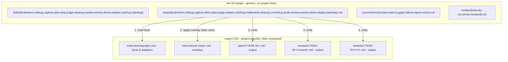

<p align="center">
  
</p>

<div align="center">

### Capture. Plan. Ship.

A language-agnostic, composable task pipeline for Claude Code.

[](https://code.claude.com/docs/en/plugins)
[](LICENSE)

</div>

---

f10 (f-ten) is a set of skills that run one chain of steps.
Three skills make up the chain:

- **capture** turns a freely written idea into a tracked task.
- **plan** turns the task into an architect-grade plan on disk.
- **ship** turns the plan into code and, optionally, a release.

The other skills are optional, and each has its place around the chain:

- **brainstorm** comes before the chain.
- **debug** comes before it too, for a bug that arrives as an error.
- **judge** runs at any point.
- **review** and **resolve** run before the PR.
- **demo** and **explain** run after the PR.
- **catchup** runs whenever the base branch moved.

No stack is hard-coded, so the same commands drive a Go service, a Rails app or a Terraform repo.
f10 **infers** what it needs: the git remote gives `gh` or `glab`, and the build files give the verify commands.
Where inference is not enough, you **declare** a fact once in `.f10/instructions/`.

## Pipeline


Solid arrows are the default flow, and dashed arrows are optional.
`brainstorm`, `debug`, `judge`, `demo`, `explain` and `catchup` run when you ask for them.
The other dashed steps run where a project declares them.
Ship also catches up on its own when the base moved.

Each skill is an **entry point** into the chain:

| Skill | Runs | Stops at |
|---|---|---|
| `/f10:brainstorm <idea>` | brainstorm | a shape agreed in chat, or the decision not to build |
| `/f10:debug <error \| trace \| desc>` | debug, capture, fetch, plan | a plan file saved on the bug path, or, for a bug that does not reproduce, no task and what to collect next |
| `/f10:judge [<idea \| id \| PR \| commit>] [--blind]` | judge | a verdict: proceed, proceed with changes, rethink, or stop |
| `/f10:capture <desc>` | capture | the task created, with its id and url |
| `/f10:plan [<id \| desc>]` | (capture,) fetch, plan | the plan file saved, before any code, or the call handed to the task's own agent |
| `/f10:ship [<id \| plan.md \| desc>]` | whatever is missing, then the flow | the end of the declared flow (an open PR by default), or the call handed to the task's own agent |
| `/f10:cleanup [comments\|prose\|code] [<path>]` | cleanup | comments cut to the why, prose rewritten for clarity, leftovers taken out of the code, each diff proven in scope (a small one gets a light pass without proofs), verify green, nothing committed |
| `/f10:review <id \| PR \| this branch> [ci] \| since [<ref>]` | review | a findings file from a reviewer that never saw your session, or one read in from the CI review. With `since`, a check of how the tasks since a ref (the last tag by default) fit together, against their plans and lore |
| `/f10:resolve <id \| PR \| this branch>` | resolve | fix, skip or ask per finding, the fixes verified, every ask in one questionnaire |
| `/f10:demo <PR \| id \| this branch> [--hands-on]` | demo | screenshots and a local report, or a scenario you walk through |
| `/f10:explain <PR \| id \| this branch \| local \| concept \| path>` | explain | for a change, what it was and what it is now. For a thing, what it is |
| `/f10:catchup` | catchup | the branch merged or rebased onto its base, conflicts settled, verify green, nothing pushed |
| `/f10:standup [--since <date> \| --week] [-C <checkout> \| --group <name> \| --all] [--other]` | standup | a report of your work by day, project and task. It is printed, and drafted wherever your settings or the project's overlay name a delivery adapter. The next report starts where this one ended |
| `/f10:status [id]` | nothing: a hook answers it, or `f10 status <id>` with an id | the run's status in words. With an id, another worktree's run and its agent's question, relayed and answered |
| `/f10:asks [id]` | nothing: it runs `f10 asks` | the questions driven agents wait on, across projects, asked in one questionnaire. Each answer resumes its drive or reaches its agent |
| `/f10:read [id \| id+id]` | nothing: it runs `f10 task read` | the task, its comments and every image it links, opened in context, with nothing planned or started |
| `/f10:board [<window>] [--state] [--remote] [-C <checkout>]` | nothing: it runs `f10 board` | what changed today (else the last working day), by group. With `--state`, every task's stage and next action, and your own next moves offered one per line (the `next` group as one line, for its first task), none of them run |
| `/f10:start <id \| PR url \| #n> [--plan \| --local \| --discuss] [--after <id> \| --base <branch>] [--task <id>] [--agent <profile> \| --model <model>]` | nothing: it runs `f10 start` | a new worktree, Herdr workspace and prompted agent, or, for a PR, its branch picked up |
| `/f10:drive <ids[:profile] \| id -- id> [--flow <name> \| --local] [--agent <profile> \| --model <model>]` | nothing: it runs `f10 drive` in the background | every task through its chain (plan, judge, ship, review, resolve, finish by default), bases first. A parent id expands into the subtasks you pick. Agents' questions are relayed |
| `/f10:finish [<id>] [--yes] [--merge \| --local]` | nothing: it runs `f10 finish` | the PR merged (someone else's only when you say so), the plan archived, the workspace closed, the worktree and branch gone, main pulled |

## Install

```
/plugin marketplace add amberpixels/f10
/plugin install f10@amberpixels
```

Per-repo setup is optional.
With no `.f10/`, the steps infer what they can from the git remote and the build files, so you can run f10 right away.
To pin a fact instead, such as the tracker, the verify commands or the PR flow, declare it in `.f10/instructions/project.md`.
Anything you leave out stays inferred.

Tasks on GitHub or GitLab issues need nothing more.
For a Notion tracker, install [f10-drivers](https://github.com/amberpixels/f10-drivers) and point `.f10/driver` at it.

## Quick start

```text
/f10:brainstorm public API abuse - rate limiting, or per-tenant quotas?
# → a discussion that writes nothing and ends in a shape, or in "we don't build this"

/f10:debug panic: assignment to entry in nil map at cache.go:42
# → reproduces the bug and finds its cause first; only a confirmed bug becomes a task and a plan

/f10:capture Add rate limiting to the public API
# → creates the tracker task and replies with its id and url

/f10:plan ABC-1042
# → investigates the code, writes .f10/plans/ABC-1042.md, and stops before any code

/f10:ship ABC-1042
# → reuses the saved plan, then runs the flow's entries after plan

/f10:ship fix the flaky retry test
# → or skips the ceremony: captures, plans and ships a small chore in one go

/f10:review
# → a reviewer that never saw this session reads the branch's diff and writes .f10/reviews/ABC-1042/1.md

/f10:resolve
# → fix, skip or ask per finding, the fixes verified, every ask in one questionnaire at the end

/f10:explain
# → what this branch was and what it is now, in a few lines; it runs nothing and writes nothing

/f10:explain grace period
# → what a grace period is, the way the peer who wrote it would tell you: three or four sentences from the code

/f10:demo
# → before you merge: runs the branch, captures what it does, and writes a local report.html

/f10:demo --hands-on
# → the same setup, but you drive: a live url and a short scenario to click through
```

`--dry-run` on any skill reports the loaded context, the routing, the adapters and the output paths, and executes nothing.
`--help` on any skill lists every argument it takes, because the autocomplete hint shows only the common call.

## Concepts

These are the terms the skills, and the rest of this README, use.

**Pipeline**

- **Step** - the unit of work, one file in `steps/*.md`.
  Skills are thin routers over steps.
- **Flow** - the steps a task runs through, in order.
  A project declares its flows under `flows:` in `project.md`, and `f10 flow` lists them.
  With none declared, the flow is `plan implement pr`.
  `plan` leads a flow, and it runs only for a task with no plan file.
  `/f10:ship` runs the entries after it.
  An entry can take an argument after a colon: `review:local`, `review:ci`, `review:local+ci` (both halves, one resolve), `cleanup:comments,prose`, `deploy:staging`.
  A `judge` entry before `implement` judges the plan, and one after `implement` judges the change.
  A name with no generic step, such as `e2e`, is project-defined: its `.f10/instructions/<name>.md` *is* the step.
  `f10 start` and `f10 drive` run the `default` flow, `--local` runs `local`, and `--flow <name>` runs any other.
  A flow with no leading `plan` skips the plan file, and for free text it skips the ticket too.
- **Brainstorm** - the optional conversation before capture, about what to build, whether to build it, and in which shape.
  It writes nothing and draws no glyph in the status line.
  It ends in a shape you hand to `/f10:capture`, or in the decision not to build.
- **Judge** - a verdict on an idea, a task, a plan, a PR or a commit range.
  It weighs whether the problem is real or only stated, whether the change treats a symptom or the cause, what already exists, and what shape would last longer.
  `--blind` runs it in a fresh agent that never saw the conversation.
  Inside a flow, proceed continues the run and stop ends it blocked.
  The other two verdicts, proceed with changes and rethink, open a discussion that ends in your call.
  With `stale_after: 3w` in the frontmatter, a task older than three weeks is judged before it is planned, and only a proceed verdict lets the plan go on.
  The judge creates nothing.
- **Review** - the bug hunt, in two halves, review and resolve.
  `review` gives the full diff to a **blind** reviewer, one that never saw your session.
  That reviewer is the default when the project declares nothing.
  It checks four core categories: correctness and logic, architecture and guidelines, security and performance, and tests and docs.
  It reports at most three findings per category, and skips style unless it affects correctness.
  The findings go to a **findings file**.
  A project adds categories under `project.md → Review`, each with a source-of-truth file, and lists what never to flag.
  `resolve` gives each finding a verdict: `fix`, `skip` or `ask`.
  `+note` adds a code comment, and `+reply` answers the reviewer.
  Resolve re-verifies the fixes and puts every `ask` to you in one questionnaire.
  Your stated choice beats the reviewer.
  One round is the default.
  A second round runs only when round one fixed six or more findings, when `project.md → Review` says `Rounds: 2`, or when you ask for it.
  The second round reports on every prior finding first.
  There is no third round, so whatever is still open goes to you.
  A review is local (before the PR) or CI or human (after it), and each flow places it or leaves it out.
  A `review` entry in a flow runs both halves.
  With no `review` entry, ship stops at the PR.
- **Demo** - shows *what was built*, so you know what code you did not write does before you merge it.
  It says what changed in plain words, then runs a **demo script** that takes screenshots and writes a local `report.html`.
  With `--hands-on`, it seeds the state and hands you the running app instead.
  The executor, which runs the app for the demo, is declared and never guessed.
  For a project with no `demo` overlay, demo proposes one from the project's e2e config, dev-server recipe, seed task and test user, and writes it to `.f10/instructions/demo.md`.
  The overlay also says where reports go: a local file, a private published page, or both.
  `--publish` or `--local` overrides that for one run.
  A demo takes one shot per claim, and a before and after only where something visible already existed.
  Its report has rows only for the artifacts it wrote.
  A demo hunts no bugs and gives no verdict.
- **Explain** - answers *what is this*, for a reader who knows the codebase.
  A change becomes two to five **pairs**, each saying what something was and what it is now.
  A concept, file, package or function gets three or four sentences from the code.
  It costs less than a demo, so run it first.
- **Catchup** - brings a branch up to date with its base: the branch `f10 start --after` recorded, else the default branch.
  It merges or rebases, as the `catchup: merge | rebase | off` frontmatter key says, and it rebases by default.
  It keeps both sides' intent.
  Lock files are regenerated, and only the files that are truly ambiguous are put to you, in one questionnaire.
  A red verify after a clean integration is a semantic conflict, and catchup settles it the same way.
  A run with nothing to settle is a correct run.
  Ship hands off to catchup when it meets a conflict.
  Catchup pushes nothing.
- **Convention** - a rule every step obeys, kept in `conventions/`:
  - `context.md`: loading the config, the core of `project.md`, stealth, and task references
  - `latency.md`: a run's cost is its turns, not its commands
  - `gaps.md`: open decisions
  - `failure.md`: a step that cannot complete
  - `report.md`: what a successful step prints
  - `voice.md`: how a run talks and how f10 writes

  A hook tells the model to load the conventions when a skill starts, and again after compaction.
  The project's instructions reload on every run.
- **Mode** - a way of running a skill that changes how it executes, kept in `modes/`:
  - `help.md`: `--help`
  - `dry-run.md`: `--dry-run`
  - `driven.md`: `--driven`, a run prompted from another session
  - `forward.md`: a task id that another worktree holds

**Artifacts**

- **Task** - the tracker item.
  Its **task id** names every artifact downstream.
  Its **kind** is `feature`, `bug`, `refactor` or `spike`, and the plan records it.
  f10 reads the kind from the steering, a label or the description.
  Only the steering or a label can make a task a spike, because a spike skips the PR.
  A bug is reproduced and its cause traced before it is planned.
  Its fix starts with a test that fails first.
  A refactor proves that behavior did not change, with tests green before and after.
  A spike is a research task that answers a question.
  Its run ends at a spike report, and its code is never committed.
- **Stage** - one ordered unit inside a plan file.
  It is not a step and not a skill.
- **Plan file** - `<storage root>/plans/<TASK-ID>.md`, which hands the work from plan to ship.
  The storage root (see **Storage** below) is anchored to the checkout root, whatever directory you launched from.
  A plan that exists only in chat is a failed run.
  A superseded plan is archived, never edited.
  The plan closes with **Consequences**, which says what the chosen design costs and when to revisit it, and then **Gaps**.
  Its `Size:` line says small, normal or large, by how much the implementer still has to design.
  A small plan is one stage, and its Consequences and Gaps are one-liners ending in `- none`.
- **Findings file** - `<storage root>/reviews/<TASK-ID>/<round>.md`, which carries a review to resolve.
  It holds the reviewed sha, then one block per finding: a title, a summary, the file and line, the category and a concrete fix.
  Resolve appends its verdicts and never edits the reviewer's text.
  A task has two rounds at most.
  The findings files stay in the checkout's `.f10/`, because `f10 finish` archives only the plan.
- **Verdict file** - `<storage root>/verdicts/<TASK-ID or slug>/<n>.md`, one per judge run.
  It opens with a header: the subject, the verdict, its reason and, in a ship run, what the run decided.
  The argument follows the header.
  An idea with no task files its verdicts under a slug of the idea.
- **Spike report** - `<storage root>/spikes/<TASK-ID>.md`, what a spike's run ships.
  It holds the question, the answer, its evidence, the recommendation and the follow-up tasks.
- **Gap** - a decision only you can make.
  The plan records each gap with a default, so the plan can always ship.
  Filling the gaps is one optional questionnaire.
- **Shipment** - what a ship run leaves, named by the flow's last step: verified code (`implement`), local commits (`commit`), pushed commits (`push`), an open PR/MR (`pr`), or a running environment (`deploy`).
  A spike's shipment is its spike report.
  A project whose flow has no git step still ships.

**Project binding**

- **Project instructions** - `<checkout root>/.f10/instructions/`, which holds `project.md` and optional per-step **overlays**.
  `project.md` keeps typed facts in its frontmatter and prose below it.
  A linked worktree's instructions layer on top of main's, unless they declare `layering: replaces`.
- **Role** - each step runs under a base role.
  A project can replace the base role, always or by area (`= senior marketing analyst` on report work).
  It can also add roles, always or by area (`+ senior UI/UX engineer` when the task touches user-facing UI).
  Fetch settles the areas and the base role, and the plan file records the roles for ship ([Roles](docs/project-setup.md#roles)).
- **Adapter** - how a capability, such as "fetch a task", "open a PR" or "verify", binds in a project: a skill or a CLI command.
  f10 names the capability, and the project supplies the adapter.
- **Remote review** - a review that CI or a human posts on the PR after it opens.
  `project.md → Review` declares it in four facts: who posts it, where it arrives, what triggers it, and what marks it done and handled.
  It also declares the mark a settled review gets.
  `f10 init` infers these facts from a Claude Code review workflow, and `f10 review pick|wait|ack|settle|trigger` acts on them.
  `/f10:review <id> ci` reads the latest remote review in, triggers a new one, or hands it to `/f10:resolve <id> ci`.
  `/f10:resolve <id> ci` reads the review in, settles it and marks it.
  A declared human reviewer answers the asks on a remote review.
  A local round's asks come to you.
- **Visibility** - `stealth` (the default) or `public`.
  Stealth work reads as if f10 never existed: commits, PRs, tickets and code comments never mention it, and `.f10/` stays untracked through `.git/info/exclude`.
- **Storage** - where the plans, findings and other files live.
  `in-repo` is the default: the main checkout's `.f10/`, shared by every worktree.
  `out-of-tree` is `~/.f10/<project>/`, which holds the instructions *and* the plans for every worktree, and puts nothing inside the project directory.
  f10 uses it when the repo has no `.f10/instructions/`.

## Generic vs. project-specific



A project's instructions extend the generic steps in layers, and a later layer wins over an earlier one.
The layers come in this order:

1. the generic step
2. `main/project.md`
3. `main/<step>.md`
4. `worktree/project.md`
5. `worktree/<step>.md`

Inferred defaults fill in only what no layer declares.
`conventions/context.md` holds the full contract.

The loader prints all of it in one bundle, the generic step files included, so a run never reads `steps/` by hand.

A linked worktree's instructions layer on top of main's.
A worktree with no instructions of its own takes main's whole.
A worktree that declares `layering: replaces` shuts main's out.

Plans never layer.
They go to the storage root, which by default is the main checkout's `.f10/`, so every worktree shares them.

## Status line

Most of a run scrolls past unseen.
So f10 shows where a run is in Claude Code's [status line](https://code.claude.com/docs/en/statusline): three glyphs, one per phase, behind an F10 keycap icon.


Done is green, and running is bright cyan.
The keycap is the Nerd Font glyph `md-keyboard_f10` (U+F12B4).
The image is a drawing, not a screenshot, because outside a patched terminal font that private-use codepoint shows as an empty box, and GitHub is no exception.

| glyph | phase state |
|---|---|
| `○` | pending - has not run |
| `◎` | running |
| `●` | done |
| `◉` | prior - done before this run (`/f10:ship ABC-1` reusing a saved plan) |
| `◌` | skipped - will not happen this run (a planless flow never plans) |
| `󰅚` (U+F015A) | partial - stopped, but work survived (committed but push failed, PR open but CI red) |
| `✗` | failed - the run stopped here with nothing usable |
| `󰜺` (U+F073A) | blocked - a judge verdict ended the run; nothing broke, the user decided |

Partial's `󰅚` is `md-close-circle-outline` (U+F015A), and blocked's `󰜺` is `md-cancel` (U+F073A).
Both are Nerd Font private-use codepoints.
GitHub shows them as empty boxes, and a patched terminal font draws them correctly.
The code spans hold the real characters, so copying one gives you the glyph.

Each state has its own shape.
Color only reinforces the shape, because red and green look the same in a daltonized theme.
`NO_COLOR` or `F10_STATE_COLOR=0` drops the color.

A normal run stays three glyphs wide.
A run that stopped adds the step it stopped at, so `◉ ● 󰜺 judge` reads as "blocked at judge".
`f10 status` shows the task, the reason and what unblocks it:

```
task      GH-26
url       https://github.com/amberpixels/f10/issues/26
capture   prior
plan      done
ship      blocked at judge
note      stop: the change patches the symptom, the cause is the retry loop in sync.go
next      move the retry into the client and re-run /f10:ship GH-26
updated   4m ago
```

Bare `f10 status` reads the current task the same way `f10 status <id>` does, gates included.
The current task is the one this session's run records, else the one the branch or the worktree's name carries.

In the main checkout, the branch names no task.
There, a session that ran `f10 start` or `f10 drive` gets a `launched here` tree first.
The tree has a row for each live task the session started or drove, nested under its `After:` base the way a parent's subtasks are.
Finished tasks, and drives that are done or cancelled, are left out.
With `--json`, the tree prints as task rows.

When there is no task to name, `f10 status` in a terminal lists this repo's live runs.
`--all` lists the runs of every session on the machine, and `--json` prints them for scripts.
When a task is named, `--json` takes the shape that `f10 status <id>` prints: a run list, the fallback object, or task rows.

Inside a session, `! f10 status` already has the session id.
`/f10:status` is answered by the plugin's hook before a model runs, so it costs no tokens.
The exception is a `launched here` tree that holds a question a driven agent waits on.
That goes to the model, which puts the question to you and sends your answer.

`f10 status 1042` reads another run, the one in the worktree that has the task's branch.
An agent there runs **driven** ([modes/driven.md](modes/driven.md)).
Nobody watches its pane, so instead of asking there, it writes its questions to run state as one `ask` row and stops blocked.
`/f10:status 1042` puts those questions to you.
It writes your answers through `f10 asks answer`, which sends them to that agent.

<details>
<summary>Why circles-by-fill, and the three Nerd Font exceptions</summary>

When your font lacks a codepoint, the terminal takes the glyph from another font with its own baseline, and the badge renders off the line.
`◐` is missing from JetBrains Mono, Fira Code and Hack, so it is not used.
If a glyph still lands wrong, `F10_STATE_GLYPHS` replaces the set.

Three glyphs are Material Design icons that only [Nerd Fonts](https://www.nerdfonts.com) carry:

- The label is `md-keyboard_f10` (U+F12B4), because it draws a whole keycap in one cell.
- Partial is `md-close-circle-outline` (U+F015A), because no crossed circle exists in all of those fonts: `⊗` is absent from Fira Code.
- Blocked is `md-cancel` (U+F073A), because `⊘` is missing even from the Nerd Fonts.

In any other font, each of the three degrades to one empty box, and the circles still read.

</details>

### Wiring it up

Claude Code applies only `agent` and `subagentStatusLine` from a plugin's settings, so a plugin cannot ship a `statusLine`.
Add the lines below to your own status line in `~/.claude/settings.json`.
At every session start, f10 points `~/.claude/f10/statusline` at its current install, so the path survives plugin updates:

```sh
input=$(cat)                                                             # you already do this
f10=$(printf '%s' "$input" | "$HOME/.claude/f10/statusline" 2>/dev/null)  # ← add
printf '%s@%s%s %s' "$user" "$host" "$f10" "$dir"                        # ← drop it in anywhere
```

The segment brings its own leading space, and it is empty when no run is live.
So it fits anywhere, even between `user@host` and the directory.

Also set `"refreshInterval": 2` on `statusLine`.
Without it, the status line refreshes only on assistant messages, so a long implement step shows a stale glyph.

`f10 doctor` says whether the status line is wired.
`f10-state.sh doctor` reports where state lives, whether the symlink is in place, and what the badge renders now.

The badge's state is one small file per session in `~/.claude/f10/state/`.
It lives outside every repo, because stealth wants nothing f10-shaped inside a project.
`/clear` starts a new session, which retires the badge.
A state file older than the TTL stops rendering.

| variable | default | |
|---|---|---|
| `F10_STATE_DIR` | `~/.claude/f10/state` | where state files live |
| `F10_STATE_TTL` | `86400` | seconds before a badge reads as stale |
| `F10_STATE_COLOR` | `1` | `0` (or `NO_COLOR`) for shapes without color |
| `F10_STATE_LINK` | `1` | `0` to drop the hyperlink on the task id |
| `F10_STATE_GLYPHS` | `○ ◎ ● ◌ ✗ ◉ 󰅚 󰜺` | pending, running, done, skipped, failed, prior, partial, blocked |

An override of `F10_STATE_GLYPHS` must give all eight positions.
The last two in the default hold the real U+F015A and U+F073A characters.
`F10_STATUS_GLYPHS` does the same for the four icons in `f10 status` trees: open PR, merged PR, review and judge ([docs/cli.md](docs/cli.md)).

<details>
<summary>How the badge stays current: two writers</summary>

- **Hooks** (`hooks/hooks.json`) - every state hook runs `f10 hook`, which reads the payload once.
  `UserPromptExpansion` and `PreToolUse` catch a skill starting, whether you typed it or the model invoked it.
  They read its argument to tell a description, which is routed through capture, from a task id.
  `UserPromptExpansion` also answers a bare `/f10:status`: it writes a blocking verdict on stdout, which ends the turn.
  The same two events, and `SessionStart` after a compaction, inject the conventions through `f10-inject.sh`.
  They send them in chunks under Claude Code's per-hook cap, once per session and again after a compaction dropped them.
  A per-session marker records whether the session holds them.
  `PostToolUse` turns what a run produces into typed observations: an issue or PR created, a commit, a push, a step loaded, `f10 finish`, a plan or findings file written.
  A few of those observations set the badge.
  A plan file written sets "plan done" and the task id.
  A ship step loaded sets that step running.
  The issue capture creates names the task.
  `Stop` closes out whatever is still running.
  `SessionStart` prunes dead state and refreshes the symlink.
- **Steps** - each step makes one `f10-state.sh set` call as each phase opens and closes.
  The calls are **cosmetic and best-effort**, as `conventions/report.md` says.
  The script forwards each call to `f10 state`, and with no binary installed yet, the call does nothing.

Steps report precisely, and hooks report reliably.
For example, `Stop` closes a run whose last badge call the agent dropped.
A phase left `pending` means that nobody reported on it.

Both writers also append to a local ledger, `~/.f10/f10.db`, a SQLite file outside every repo.
The ledger records:

- what the hooks observed
- what the artifacts (plans, findings, verdicts) hold
- every badge call, as the model claimed it
- every halt and finish that `f10 drive` made itself

Each row is tagged with its source.
A write that fails goes to `~/.f10/ledger.spool`, and the next write replays it.
`f10 ledger dump` prints the rows.

</details>

Claude Code's [`footerLinksRegexes`](https://code.claude.com/docs/en/settings#footer-link-badges) setting is not part of f10, but it pairs well with it.
It turns a task id in a reply into a clickable badge in the footer, with one regex per tracker and no script.

## The binary

The plugin needs the `f10` binary, and it fetches the binary itself.
Its `bin/f10` shim runs the build that matches the plugin's version.
The shim downloads that build from this repo's public release with `curl`, or builds it from the plugin's `cli/` when Go is installed.
[docs/cli.md](docs/cli.md) has the resolution order, the cache and the release details, and the full reference for every command.

`f10 config` prints a repo's effective configuration, with where each value came from (`detected`, `declared (main)`, `declared (worktree)`, `default`, `absent`), the way `git config --show-origin` does.
`--json` prints it for scripts.

```bash
just install   # dev: rebuild this checkout's cli/ into the shim's cache and $GOBIN
f10 --version  # the plugin's version, through the shim
f10 config
f10 doctor     # is the plugin, the binary and the environment wired up? changes nothing
```

`f10 --help` lists the commands a person types.
The verbs that steps and skills call, such as `f10 trace`, `f10 review` and `f10 task ref`, are plumbing.
`f10 help --all` lists them under their own headings: top-level ones under `plumbing:`, and subcommands by their full path under `PLUMBING SUBCOMMANDS:`.
`f10 help --agent` prints one line per command, generated from the command definitions.
`bin/f10-inject.sh` tells every f10 skill that runs a step to load that output beside the conventions, so the agent's context holds the CLI as it was built.

`f10 doctor` checks both halves of the install, the plugin and the binary, and what they need.
It prints a remedy line for each check that fails.
It checks:

- that the plugin and binary versions agree
- that the plugin's scripts are on `PATH`
- that its hooks are registered, or are waiting on a restart
- that the status line is wired
- Herdr
- the host CLI's login
- `project.md`'s frontmatter

`f10 init` writes `.f10/instructions/project.md` from what the probes found: stack, tracker and id format, host and PR CLI, verify commands, storage and visibility.
It also adds the stealth `.f10/` line to `.git/info/exclude`.
A section it could not detect is left out, not stubbed.
The `Project` one-liner is yours to write.
`f10 init` never overwrites an existing file, and the file's existence is what marks a repo as an f10 project.

### Lookaround

The same binary reads what that configuration points at, with the repo's own tool: `gh` for one repo, `glab` for another, and your driver where the tracker has no CLI.

```bash
f10 task read            # the current task as markdown - from the branch, or this session
f10 task open 1042       # in the browser
f10 task open --print    # the open tasks, first page, as rows ranked by priority (no id: the list, in the browser)
f10 task search billing  # rows, not a picker
f10 plan read            # the plan saved for that same task
f10 demo open            # the demo report for it, in the browser
f10 pr open [n]          # a PR or MR, or with no number their list; gh or glab decided by the remote
f10 review pick|wait|ack|settle|trigger # the remote review on that PR: read it, await it, mark it handled, then settled, or ask for one
f10 status               # where the current task's run is, as `f10 status <id>` reads it; with no task, this session's or this repo's live runs
f10 status 1042          # a task's run in its own worktree, the question its agent waits on included
f10 board                # what changed today (else the last working day): started, updated, reviewed, finished, new tasks
f10 board --state        # where every task stands: done, in progress with its stage and next action, next
f10 ledger dump          # what runs recorded locally (--json, --project ., --task, --session)
```

A reference is any id shape (`1042`, `#1042`, `ABC-1042`) or the task's url.

Each verb means the same under every noun.
`read` writes content.
`open` follows an address, and `--link` writes the address instead, for a pipe.
`search` finds by description.

`task open` and `pr open` with no argument open the list.
With `--print`, they write the list to the terminal instead, as rows of the first page, with tasks ranked by priority.
`--print` with an id writes that item.
Every other verb given no argument takes the id in the branch name, else the task this session recorded.

`-C` answers for another checkout, so you need no `cd`:

```bash
f10 -C ../r3 task read 12                    # a path always works
export F10_ROOTS=~/code/github.com/*/*       # opt in, and names work too
f10 -C r3 task read 12
```

On a terminal, `read` pages through `$PAGER`.
Into a pipe, it writes raw markdown, so `f10 task read | glow` works.
Into a pipe, it also downloads the images the task links and names their local paths at the end, so an agent reads files rather than urls that expire.

Notion, Jira or any other tracker without a CLI goes through an executable at `.f10/driver`.
f10 specifies [the driver contract](docs/driver-contract.md), not the driver itself.
For Notion, [f10-drivers](https://github.com/amberpixels/f10-drivers) has a ready driver: a one-line shim and a `driver.toml`.

### Start

`f10 start` replaces three hand-offs: a worktree recipe, a Herdr tab, and claude launched with a hand-typed prompt.
Each of them is a place to lose the branch suffix, the base or "keep it local":

```bash
f10 start 1042                # branch, worktree, Herdr workspace, claude prompted with plan + ship (ship alone when main saved a plan)
f10 start 1042 --plan         # prompt the plan only
f10 start 1042 --local        # ship through the project's `local` flow: commits, nothing pushed
f10 start 1042 --flow direct  # ship through any declared flow (`f10 flow` lists them)
f10 start 1042 --discuss      # fetch the task and wait: talk it through in the new pane before any plan
f10 start 1042 --discuss "/f10:judge it first"   # fetch, run the note, then wait
f10 start 1042 --after 1040   # base the branch on that task's branch, record the dependency, stack the PR
                              # (no flag: the task body's `After:` line, when it has one)
f10 start 1042 --base rel/2   # base the branch on a git ref: the local branch, else origin's
f10 start 1042-attempt2       # a second worktree for the same task, beside the first
f10 start https://github.com/o/r/pull/77   # pick up someone's PR: its branch, linked to its task; summarise and wait
```

The branch name comes from the driver's `branch` verb, else it is `<ID>/<slug>` from the task's title.
When `wt` is on `PATH`, [worktrunk](https://github.com/max-sixty/worktrunk) makes the worktree, so the project's hooks fire.
Otherwise plain git makes it, at the same sibling path.

`f10 start` returns once the prompt is submitted, so `/f10:start` can run it from a session.
It runs only inside Herdr.
Outside Herdr, it stops without changing anything and points at https://herdr.dev.
Run a second time, it reopens the existing worktree and leaves its agent alone.
The prompt ends in `--driven`, so the agent routes every question through run state ([modes/driven.md](modes/driven.md)).

### Forward

`/f10:ship 1042` typed in the main session would ship on `main`, away from the task's branch and the work in its worktree.
So the plan and ship skills first hand the command off with `f10 forward`:

```bash
f10 forward 1042 "/f10:ship 1042"      # the command goes to 1042's agent, marked --driven
```

`f10 forward` finds the task's branch, worktree, workspace and agent, and submits the text as that agent's next prompt.
It prints three rows: task, workspace and sent.
This session's badge does not move.

An answer to a question the agent stopped on goes through the asks inbox instead: `f10 asks answer 1042 1=proceed 2="keep ours"`.

If the task's branch is checked out here, or nowhere, `f10 forward` exits 3 and the skill runs locally.
An agent that is idle while its run says running is waiting on something f10 cannot see, such as a permission dialog.
In that case, forward names the workspace and sends nothing.
Judge, demo and explain are never forwarded, because they can read another worktree's branch and they write nothing.

### Drive

`f10 drive` runs a list of tasks through their flow, from the main session:

```bash
f10 drive 1042 1043                  # each task through the default flow, bases first
f10 drive 1042 -- 1047 --local       # every id from 1042 to 1047, through the local flow
f10 drive 1042 1043 --answer "1. proceed"   # the same command, answering the question it stopped on
```

A task opens once its base's branch has a commit of its own.
Its `finish` waits until the base has finished.
Every task released this way runs at the same time.
Each one is opened the way `f10 start` opens a task, and its agent is prompted one skill at a time.
Herdr says when a turn ends, and run state says how it ended.

For each task, the drive sends `/f10:plan` when the flow leads with `plan` and the task has no plan file.
Then it sends `/f10:ship`, which runs the rest of the flow.
With `drive_finish: on`, the drive then runs `finish` itself, not through the agent.

When an agent asks a question, `f10 drive` exits 4, and the question waits in the asks inbox.
`/f10:drive` puts it to you, and your answers resume the drive.
You can also answer in the agent's pane, with `f10 asks`, or with `/f10:asks` from any session.

A judge's stop, or a failure, halts that task and its dependents.
The other tasks run on, and the drive exits 5.
When the base of a started task has just finished, the drive first catches the task up with `/f10:catchup`.
Rerunning the same command resumes from each task's last recorded skill.

A task names its base in a last body line, such as `After: 1042`.
Capture writes that line.
`f10 start` takes it as the default `--after`, and `f10 drive` runs the base first.
`f10 drive` refuses a base that is unfinished and not in the list, and it refuses circular waits.

### Finish

`f10 finish` is the inverse of `f10 start`.
It includes the two steps people skip, removing the worktree and pulling main:

```bash
f10 finish 1042          # merge the PR, pull main, archive the plan, close the workspace, remove the worktree and branch
f10 finish 1042 --yes    # the same from inside the task's own workspace, which closes after the report
```

It merges with `gh pr merge` or `glab mr merge`, or confirms that the PR is already merged.
It never merges with `--admin`.
On red CI, a required review or a conflict, it stops and gives the host's reason.

Everything after the merge waits until the merge lands in the local default branch.
The plan leaves the worktree before the worktree is removed.
Tasks started `--after` this one drop their dependency on it.

`f10 finish` checks for refusals before it changes anything.
It refuses:

- a dirty worktree, naming each file, with no `--force` to override it
- a PR stacked on another task's branch
- a working directory inside the worktree, unless `--yes` is given

`/f10:finish` turns the last refusal into one question.

### Lookaround by design

The binary leaves files where they live.
It scans other repos only after you set `F10_ROOTS`.
Only `init`, `start`, `drive` and `finish` write anything.
`drive` writes each task's last skill to the local git config.

`bin/f10-load-project.sh` stays the loader that agents use.
The binary may interpret `project.md` prose, and it shows what it cannot place as `unrecognized`.
The parity suite in `cli/internal/layout` runs every fixture through both the script and the binary.

## Development

The executable surface is `bin/` plus `cli/`.

- `bin/f10-load-conventions.sh` prints the six convention files.
  They are the same everywhere.
  It runs when the hook `bin/f10-inject.sh` says the context lacks them, and subagents run it too.
- `bin/f10-load-project.sh` loads one repo's instructions.
  Its output varies by worktree, so it runs again on every run.
- `bin/f10-state.sh` renders the status-line badge.
  It forwards badge calls to the binary, which writes the run state.

Everything in `bin/` is on the Bash tool's `PATH`, so prose names these scripts bare.

`cli/` is the lookaround binary.
It is its own Go module, `github.com/amberpixels/f10/cli`, with `cmd/f10` as its main package.
It stays in this repo because its parity tests run the scripts in `bin/`.

```bash
just lint   # shell + Go findings, change nothing (with `just test`, what CI runs)
just fmt    # rewrite shell + Go to canonical form
just fix    # apply everything auto-fixable - run on a clean tree, read the diff
just test   # go test ./..., the f10-load-project.sh parity suite included
just build  # go build ./...
```

Each root recipe covers the shell scripts in place, and Go through the `cli` module.
`just cli::test` runs only the Go part.

Shell is checked with [shellcheck](https://www.shellcheck.net) and [shfmt](https://github.com/mvdan/sh).
`shfmt -f` finds the scripts by extension *and* shebang, so a new `bin/whatever` is covered at once.
The optional shellcheck checks that are turned on are listed in `.shellcheckrc`.

Go is checked with [standardgo](https://github.com/amberpixels/standardgo), pinned in `cli/justfile`, and the repo has no lint config file.

The justfile started from [justx](https://github.com/amberpixels/just-x), but every recipe is maintained by hand now.

## Status

Two things come next.
The first is an `/f10:init` skill on top of `f10 init`, which reads the `Project` line and the guardrails out of a repo rather than detecting them.
The second is shared **profiles**: named configs that a repo's `project.md` references instead of repeating them.

## Docs

- [Setting up a project](docs/project-setup.md): `f10 init`, `project.md`, overlays, flows, storage, worktrees.
- [The status line](docs/statusline.md): wiring the badge and reading it.
- [The `f10` binary](docs/cli.md): every command, references, output.
- [The driver contract](docs/driver-contract.md): a tracker without a CLI.
- [f10-drivers](https://github.com/amberpixels/f10-drivers): ready drivers for that contract, Notion first.
- [Lore](docs/lore.md): why a line is the way it is, kept as entries per change next to the code.

## Feedback

A solo, opinionated project, but ideas, questions, and bug reports are always welcome as an [issue](https://github.com/amberpixels/f10/issues) :)

## License

[MIT](LICENSE) © [amberpixels](https://amberpixels.io)
