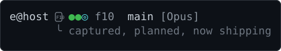

<p align="center">
  
</p>

<div align="center">

### Capture. Plan. Ship.

A language-agnostic, composable task pipeline for Claude Code.

[](https://code.claude.com/docs/en/plugins)
[](LICENSE)

</div>

---

f10 (f-ten) is a set of skills that run one chain of steps.
Three skills make up the chain:

- **capture** turns a freely written idea into a tracked task.
- **plan** turns the task into an architect-grade plan on disk.
- **ship** turns the plan into code and, optionally, a release.

The other skills are optional, and each has its place around the chain:

- **brainstorm** comes before the chain.
- **debug** comes before it too, for a bug that arrives as an error, logs or a user's complaint.
- **judge** runs at any point.
- **review** and **resolve** run before the PR.
- **demo** and **explain** run after the PR.
- **handoff** runs before the merge, listing what the change leaves for whoever ships it.
- **catchup** runs whenever the base branch moved.
- **audit** runs after a run of tasks, reviewing what shipped over a window.

No stack is hard-coded, so the same commands drive a Go service, a Rails app or a Terraform repo.
f10 **infers** what it needs: the git remote gives `gh` or `glab`, and the build files give the verify commands.
Where inference is not enough, you **declare** a fact once in `.f10/instructions/`.

## Install

```
/plugin marketplace add amberpixels/f10
/plugin install f10@amberpixels
```

Per-repo setup is optional, so you can run f10 right away.
To pin a fact instead, such as the tracker or the verify commands, run `f10 init` or edit `.f10/instructions/project.md` ([setup](docs/project-setup.md)).
Anything you leave out stays inferred.

Tasks on GitHub or GitLab issues need nothing more.
For a Notion tracker, install [f10-drivers](https://github.com/amberpixels/f10-drivers) and point `.f10/driver` at it.

## Quick start

```sh
/f10:capture Add rate limiting to the public API
# creates the tracker task and replies with its id and url

/f10:plan ABC-1042
# investigates, writes .f10/plans/ABC-1042.md, stops before code

/f10:ship ABC-1042
# reuses the saved plan, then runs the rest of the flow

/f10:ship fix the flaky retry test
# captures, plans and ships a small chore in one go

/f10:review
# a reviewer that never saw this session writes a findings file

/f10:resolve
# fix, skip or ask per finding, every ask in one questionnaire
```

`--dry-run` on any skill reports what it would load, route and write, and executes nothing.

## Skills

The chain:

| skill | what you get |
|---|---|
| `capture` | a tracker task, with its id and url |
| `plan` | a plan file on disk, before any code |
| `ship` | the project's flow run end to end, an open PR by default |

Around the chain:

| skill | what you get |
|---|---|
| `brainstorm` | a shape agreed in chat, or the decision not to build |
| `debug` | the cause of a reported problem, then a task and a plan per bug, or an answer when it is not a bug |
| `judge` | a verdict: proceed, proceed with changes, rethink, or stop |
| `cleanup` | comments, prose and leftover code tightened, nothing committed |
| `review` | a findings file from a reviewer that never saw your session |
| `resolve` | a verdict and a verified fix for each finding |
| `ci` | a red CI run triaged: fixed, rerun, or asked about |
| `demo` | screenshots and a report of what the change does (`--hands-on`: a running app and a scenario) |
| `handoff` | what the change leaves for whoever ships it |
| `explain` | what a change was and is now, or what a thing is |
| `catchup` | the branch on its base, conflicts settled, nothing pushed |
| `audit` | a report on what shipped over a window, and tasks sized to it |
| `standup` | your work since the last standup, by day and task |

Session tools, which run the binary:

| skill | what you get |
|---|---|
| `status` | where a run is, and the question its agent waits on |
| `asks` | every question driven agents wait on, in one questionnaire |
| `read` | a task and its images loaded into the session |
| `board` | what changed today (`--state`: where every task stands) |
| `start` | each task in its own worktree and agent, run through the flow, bases first |
| `finish` | the PR merged, and the worktree, branch and workspace gone |

Each runs as `/f10:<skill>`, and `--help` on any skill lists its arguments.

## Concepts

Each term has a section in [docs/concepts.md](docs/concepts.md).

**Pipeline**

- **Step**: the unit of work, one file in `steps/*.md`.
  Skills are thin routers over steps.
- **Flow**: the steps a task runs through, declared under `flows:` in `project.md`.
  With none declared, it is `plan implement pr finish`.
- **Brainstorm**: the conversation before capture, which writes nothing.
- **Judge**: a verdict on an idea, a task, a plan or a change, weighing cause against symptom.
- **Review**: the bug hunt, a blind reviewer's findings and resolve's verdict on each.
- **Demo**: what the change does, shown with screenshots before you merge it.
- **Explain**: what a change or a thing is, in a few sentences from the code.
- **Catchup**: the branch brought up to date with its base, both sides' intent kept.
- **Convention**: a rule every step obeys, in `conventions/`.
- **Mode**: a way of running a skill, such as `--dry-run` or `--driven`, in `modes/`.

**Artifacts**

- **Task**: the tracker item, whose id names every artifact downstream.
  Its kind is `feature`, `bug`, `refactor` or `spike`.
- **Stage**: one ordered unit inside a plan file.
- **Plan file**: `<storage root>/plans/<TASK-ID>.md`, which hands the work from plan to ship.
- **Findings file**: `<storage root>/reviews/<TASK-ID>/<round>.md`, which carries a review to resolve.
- **Verdict file**: `<storage root>/verdicts/<TASK-ID or slug>/<n>.md`, one per judge run.
- **Spike report**: `<storage root>/spikes/<TASK-ID>.md`, the answer a spike ships.
- **Audit report**: `<storage root>/audits/<time>-<sha7>.md`, one per `/f10:audit`.
- **Gap**: a decision only you can make, recorded in the plan with a default.
- **Shipment**: what a ship run leaves, named by the flow's last step.

**Project binding**

- **Project instructions**: `.f10/instructions/`, with `project.md` and optional per-step overlays.
  A linked worktree's instructions layer on top of main's.
- **Role**: the role a step runs under, which a project can replace or add to.
- **Adapter**: the skill or CLI command a project binds a capability to, such as "fetch a task".
- **Remote review**: a review that CI or a human posts on the PR.
- **Visibility**: `stealth` (the default) keeps every trace of f10 out of commits, PRs and tickets, or `public`.
- **Storage**: where the plans and findings live, the main checkout's `.f10/` by default.

## Status line

f10 shows where a run is in Claude Code's [status line](https://code.claude.com/docs/en/statusline): three glyphs, one per phase, behind an F10 keycap.



| glyph | phase state |
|---|---|
| `○` | upcoming |
| `◎` | running |
| `●` | done |
| `◉` | prior: done before this run |
| `◌` | skipped: will not happen this run |
|  | partial: stopped, but work survived |
| `✗` | failed: stopped with nothing usable |
|  | blocked: a judge verdict ended the run |

A plugin cannot ship a status line, so you add one line to yours.
[docs/statusline.md](docs/statusline.md) has the wiring, the colors and `f10 status`.

## The binary

The plugin needs the `f10` binary, and its `bin/f10` shim fetches the build that matches the plugin's version.
It downloads the build from this repo's release, or builds it from `cli/` when Go is installed.

```sh
f10 doctor       # are the plugin, the binary and the environment wired up?
f10 config       # the effective configuration, with where each value came from
f10 task read    # the current task as markdown
f10 start 1042   # a worktree, a Herdr workspace and an agent, run through the flow
f10 start 1042 1043
f10 finish 1042  # merge the PR, remove the worktree, pull main
```

[docs/cli.md](docs/cli.md) is the reference for every command.

## Development

The executable surface is `bin/` plus `cli/`.

- `bin/f10-load-conventions.sh` prints the six convention files, the same everywhere.
  It runs when the hook `bin/f10-inject.sh` says the context lacks them, and subagents run it too.
- `bin/f10-load-project.sh` loads one repo's instructions.
  Its output varies by worktree, so it runs again on every run.
- `bin/f10-state.sh` renders the status-line badge, and forwards badge calls to the binary.

Everything in `bin/` is on the Bash tool's `PATH`, so prose names these scripts bare.

`cli/` is its own Go module, `github.com/amberpixels/f10/cli`, with `cmd/f10` as its main package.
`cmd/f10` only wires the command tree.
Each command is a package under `internal/command`, over the services and domain packages in `internal/`.
`internal/layers` ranks every package.
Its test fails on an import from a lower rank to a higher one, or between two commands of the same rank.
`cli/` stays in this repo because its parity tests run the scripts in `bin/`.

```sh
just lint   # shell + Go findings, change nothing (with `just test`, what CI runs)
just fmt    # rewrite shell + Go to canonical form
just fix    # apply everything auto-fixable; run on a clean tree, read the diff
just test   # go test ./..., the f10-load-project.sh parity suite included
just build  # go build ./...
```

Each root recipe covers the shell scripts in place, and Go through the `cli` module.
`just cli::test` runs only the Go part.
Shell is checked with [shellcheck](https://www.shellcheck.net) and [shfmt](https://github.com/mvdan/sh).
`shfmt -f` finds the scripts by extension *and* shebang, so a new `bin/whatever` is covered at once.
`.shellcheckrc` lists the optional shellcheck checks that are turned on.
Go is checked with [standardgo](https://github.com/amberpixels/standardgo), pinned in `cli/justfile`, and the repo has no lint config file.

`proto/` holds the control-plane API, loaded as the `proto` module ([proto/README.md](proto/README.md)).
`just gen` regenerates its checked-in Go and TypeScript code, and `just lint` fails when that code is stale.

## Docs

- [Concepts](docs/concepts.md): every term above, in full.
- [Setting up a project](docs/project-setup.md): `f10 init`, `project.md`, overlays, flows, paces, storage, worktrees.
- [The status line](docs/statusline.md): wiring the badge and reading it.
- [The `f10` binary](docs/cli.md): every command, references, output.
- [Skills and steps](docs/skills-and-steps.md): what goes in a skill and what in a step.
- [The driver contract](docs/driver-contract.md): a tracker without a CLI.
- [f10-drivers](https://github.com/amberpixels/f10-drivers): ready drivers for that contract, Notion first.
- [Lore](docs/lore.md): why a line is the way it is, kept as entries per change next to the code.
- [The control-plane API](proto/README.md): the proto contract, its generated code and the rules for changing it.

## License

[MIT](LICENSE) © [amberpixels](https://amberpixels.io)
